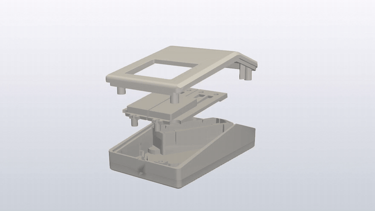
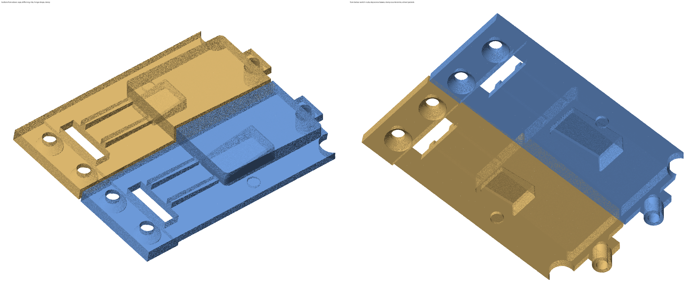

# Apple Desktop Bus Mouse (G5431) — Logitech M185 conversion

A 3D-printed shell that turns a **Logitech M185** wireless mouse into a replica of the
**Apple Desktop Bus Mouse (G5431)**, the boxy mouse that came with the Apple IIGS and the
Macintosh SE and II. The M185's guts (PCB, sensor, switches, battery contacts) are reused; the
printed parts replace the stock case. Unlike the one-button original it has **two buttons**,
and with no cable the front is closed.

It is the third of a set, after the [Lisa mouse](https://github.com/wottle/lisa-mouse-logitech-m185)
and the [Macintosh mouse](https://github.com/wottle/mac-mouse-logitech-m185), and reuses the Lisa
mouse's M185 mounting, power slider and battery door. The door's main plate has a lower battery
saddle here, because this mouse is lower-profile than the Lisa mouse (see below).



*The printed parts coming apart and together (render; [10 s MP4, 720p](images/animation.mp4)).*

> **Status: not yet printed.** Everything here is checked in the model only (parts against each
> other and against stand-ins for the M185 parts, at rest and pressed). See [Known issues](#known-issues).

## What you need

| Item | Notes |
|------|-------|
| **Genuine** Logitech M185 wireless mouse | Donor for the electronics. Knock-offs sold as the M185 have a different PCB and will not fit. |
| 3D printer + PLA | Parts fit a 0.4 mm nozzle. See [docs/PRINTING.md](docs/PRINTING.md). |
| Small Phillips screwdriver | For the M185's own screws. |
| 1 × AA battery | Alkaline AA. |
| PTFE mouse slides (optional) | The underside is flat with no feet. |
| M3 screws | See the table below. |

### Screws

Holes use the same sizes as the Lisa and Macintosh mice: 2.7 mm pilot, 3.3 mm clearance.

| Use | Screw | Qty |
|-----|-------|:---:|
| PCB, rear boss | M3×4 flat head | 1 |
| PCB, front standoff in the scroll-wheel cutout (add a washer for more grip) | M3×6 | 1 |
| Buttons, clamped under the hump (from inside) | M3×6 countersunk | 4 |
| Button stop screws, one per button (set the click point) | M3×8 pan or cap head | 2 |
| Case, four corners, from underneath | M3×12 countersunk (M3×10 also works) | 4 |

## Printed parts

STL files are in [`models/`](models/), in three folders:

| Folder | What |
|--------|------|
| [`models/common/`](models/common/) | Buttons, battery door and power slider: the same however you print. |
| [`models/fdm/`](models/fdm/) | The two shells for **FDM**: flat, parallel sides and a 45° bevel along the top's side edges, so the shells print on their sides without banding or supports outside (see [PRINTING.md](docs/PRINTING.md)). |
| [`models/resin/`](models/resin/) | The two shells for **resin**: the original G5431's sloping sides and rounded top edges. Everything else matches the FDM shells. |

Print the shells from one of `fdm/` or `resin/`, and everything in `common/`. Dimensions are the
bounding box in the model's design orientation (X × Y × Z, mm). The new parts are in assembled
position in one common frame (X right, Y toward the buttons, Z up, underside at Z = 0).

| File | Qty | Size (mm) | Purpose |
|------|:---:|-----------|---------|
| `fdm/lower_shell.stl` or `resin/lower_shell.stl` | 1 | 57.0 × 98.5 × 24.2 (resin: 57.4 wide) | Bottom shell. ADB outline with the M185 mounting inside: PCB seats, rear screw boss, front standoff, sensor window, power-switch slot, diagonal AA bay, battery door opening. Flat underside with a 1 mm 45° bevel. |
| `fdm/upper_shell.stl` or `resin/upper_shell.stl` | 1 | 57.0 × 98.5 × 23.5 (resin: 57.4 wide) | Top shell. The original form and button window; the original button mount and cable ribs are removed, and four bosses under the hump hold the buttons. |
| `common/button_left.stl` | 1 | 22.2 × 60.4 × 15.1 | Left button: cap, flexing plate, clamp. **Short throw** (the default): the click comes almost as soon as you press. |
| `common/button_right.stl` | 1 | 22.6 × 60.4 × 15.1 | Right button, short throw. |
| `common/button_left_long.stl` | (1) | 22.2 × 60.4 × 15.1 | Left button, **longer throw**: about 0.5 mm more travel at the front edge before the click, for a more deliberate press. Print this pair *or* the pair above. |
| `common/button_right_long.stl` | (1) | 22.6 × 60.4 × 15.1 | Right button, longer throw. |
| `common/on_off_button.stl` | 1 | 12.0 × 7.2 × 6.0 | Power switch slider. Unchanged from the Lisa mouse. |
| `common/battery_cover_1.stl` | 1 | 14.7 × 53.1 × 6.4 | Battery door, main plate: the Lisa mouse's, with the saddle that holds the cell 2.4 mm lower and a lower latch box whose roof is shaped to the cell. **Use this one, not the Lisa or Macintosh mouse's** (see Known issues). |
| `common/battery_cover_2.stl` | 1 | 7.2 × 12.1 × 6.2 | Battery door, latch piece: the Lisa mouse's, with its latch tab moved 0.5 mm deeper (toward the battery) and 0.3 mm longer so it reaches its slot, a thinner arm and a thinner, softer spring. **Use this one** (see Known issues). |


## How the buttons work



Each button is one piece: a cap in its half of the original window, on a plate that runs under the
roof and is screwed up into two bosses under the hump. The plate bends at a thin hinge in front of
that clamp (a flexure, like the original ADB button), so there are no hinge pins to sag or bind.

- A small printed **nub** under each plate sits directly over its M185 switch.
- An M3 **stop screw** in a boss under the front of each plate pushes against the inside of the roof,
  just in front of the window. Screwing it in lowers the button's resting position, which brings the
  nub down onto the switch. This sets the click point, as the striker screws do on the Lisa and
  Macintosh mice.
- The M185's **scroll-wheel encoder**, under the right button, has to be desoldered: on the first
  print it got in the way of that button. The **middle-click switch** can stay on the board: it sits
  well below the left button, and nothing touches it. Neither cap is pocketed underneath.
- The caps rise slightly towards the front: 0.3 mm above the roof at the window's rear edge, 0.8 mm
  at its front, because the buttons rest a little nose-down on their hinges.
- The caps have 0.6 mm of clearance to the window all round, and the plates about 1 mm to the side
  walls, so the buttons move freely with the upper shell printed on its side.


## Build it

1. **Print** the parts — [docs/PRINTING.md](docs/PRINTING.md)
2. **Assemble** — [docs/ASSEMBLY.md](docs/ASSEMBLY.md)

## How it differs from the original G5431

- Two buttons: the window is split between two caps with a 0.8 mm slot.
- No cable: the cable slot in the front wall is closed.
- The underside is flat, without the ball opening and feet.
- The case screws are in the original four corners, now M3.
- FDM shells only: the sides are flat, vertical and parallel, 57.0 mm apart (the original's lean in
  slightly and narrow toward the front, 52–57 mm), and the top's side edges are a 2 mm 45° bevel instead
  of a curve, so the shells print on their sides without banding or outside supports. The resin shells
  keep the original's sides and edges.

## Known issues

- **Two button pairs.** The default buttons (`button_left.stl`, `button_right.stl`) have a short
  throw: the click comes almost as soon as you press. The longer-throw pair (`button_left_long.stl`,
  `button_right_long.stl`) has about 0.5 mm more travel at the front edge before the click, for those
  who want each press to be more deliberate.
- **Battery door.** This mouse's battery door is not the same as the Lisa and Macintosh mice's, to
  suit this lower-profile shell. `battery_cover_1.stl` has the battery saddle 2.4 mm lower, and the box
  the latch slides into is lower with its roof shaped to the cell, so the cell lies level on both. The
  latch piece `battery_cover_2.stl` has a thinner arm to fit that box, a thinner spring, and its tab
  moved 0.5 mm deeper, toward the battery, and 0.3 mm longer, so it still reaches its slot.
  Use both from this repo, as a pair: neither fits the Lisa mouse's other half.

## Repository layout

```
models/     Print-ready STLs: common/ (both ways), fdm/ and resin/ (the two shells)
docs/       Printing and assembly instructions
images/     Renders and the section drawing
scripts/    build_models.py rebuilds models/ from source/ and runs the fit checks
source/     Input meshes (see source/README.md)
```

## Rebuilding the models

```
pip install -r scripts/requirements.txt
python3 scripts/lisa_solid.py        # once
python3 scripts/build_models.py
python3 scripts/sections.py          # optional: images/sections.png
```

The script rebuilds every part, then checks every pair of parts and the M185 stand-ins for overlap,
at rest and with each button pressed, and ends with `problems: N`. The dimensions most likely to need
changing are constants at the top of `scripts/build_top.py` (nub gap, stop screw, hinge, clamp,
clearances) and `scripts/geo.py` (where the board sits: `BOARD_X`, `BOARD_Y`).

## Credits

This project is a remix of existing models. Thank you to their creators:

- **Apple Desktop Bus Mouse - Model G5431 (Shell)** by StephenLulz —
  <https://www.thingiverse.com/thing:4545460>, licensed CC BY-NC-SA. The outer shells come from
  this model.
- **Apple Lisa mouse** — <https://www.thingiverse.com/thing:6547918>
- **Amiga Mouse (Logitech M185)** — the inner mounting for the M185 electronics originally comes
  from this model: <https://www.printables.com/model/1137373-amiga-mouse-logitech-m185>

The M185 mounting, power slider and battery door are taken from the
[Lisa mouse conversion](https://github.com/wottle/lisa-mouse-logitech-m185).

## License

[CC BY-NC-SA 4.0](LICENSE) — share and adapt with attribution, non-commercially, under the same license.
