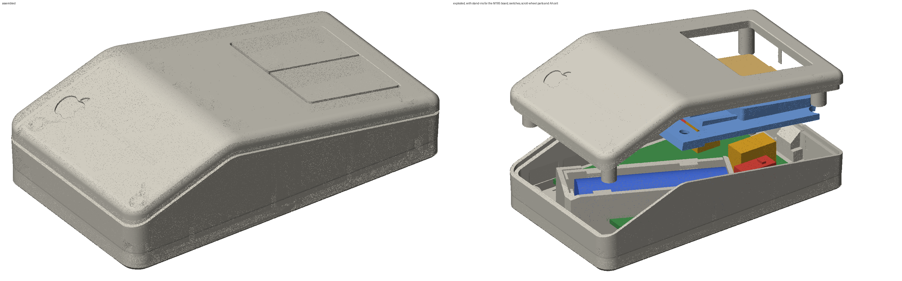
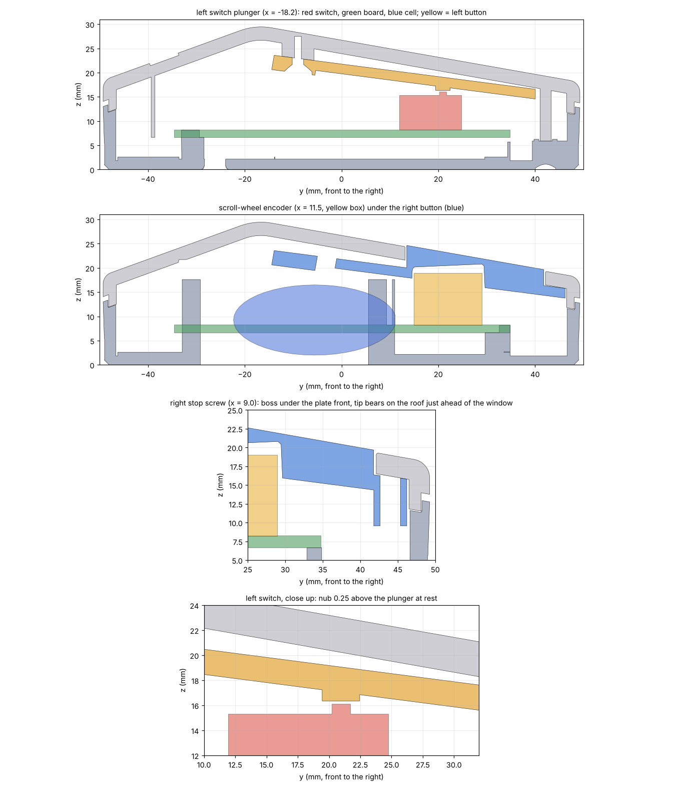

# Apple Desktop Bus Mouse (G5431) — Logitech M185 conversion

A 3D-printed shell that turns a **Logitech M185** wireless mouse into a replica of the
**Apple Desktop Bus Mouse (G5431)**, the boxy mouse that came with the Apple IIGS and the
Macintosh SE and II. The M185's guts (PCB, sensor, switches, battery contacts) are reused; the
printed parts replace the stock case. Unlike the one-button original it has **two buttons**,
and with no cable the front is closed.

It is the third of a set, after the [Lisa mouse](https://github.com/wottle/lisa-mouse-logitech-m185)
and the [Macintosh mouse](https://github.com/wottle/mac-mouse-logitech-m185), and reuses the Lisa
mouse's M185 mounting, power slider and battery door.



> **Status: not yet printed.** Everything here is checked in the model only (parts against each
> other and against stand-ins for the M185 parts, at rest and pressed). See [Known issues](#known-issues).

## What you need

| Item | Notes |
|------|-------|
| **Genuine** Logitech M185 wireless mouse | Donor for the electronics. Knock-offs sold as the M185 have a different PCB and will not fit. |
| 3D printer + PLA | Parts fit a 0.4 mm nozzle. See [docs/PRINTING.md](docs/PRINTING.md). |
| Small Phillips screwdriver | For the M185's own screws. |
| 1 × AA battery | Alkaline AA. |
| PTFE mouse slides (optional) | The underside is flat with no feet. |
| M3 screws | See the table below. |

### Screws

Holes use the same sizes as the Lisa and Macintosh mice: 2.7 mm pilot, 3.3 mm clearance.

| Use | Screw | Qty |
|-----|-------|:---:|
| PCB, rear boss | M3×4 flat head | 1 |
| PCB, front standoff in the scroll-wheel cutout (add a washer for more grip) | M3×6 | 1 |
| Buttons, clamped under the hump (from inside) | M3×6 countersunk | 4 |
| Button stop screws, one per button (set the click point) | M3×8 pan or cap head | 2 |
| Case, four corners, from underneath | M3×12 countersunk (M3×10 also works) | 4 |

## Printed parts

STL files are in [`models/`](models/). Dimensions are the bounding box in the model's
design orientation (X × Y × Z, mm). The four new parts are in assembled position in one common
frame (X right, Y toward the buttons, Z up, underside at Z = 0).

| File | Qty | Size (mm) | Purpose |
|------|:---:|-----------|---------|
| `lower_shell.stl` | 1 | 57.4 × 98.5 × 24.2 | Bottom shell. ADB outline with the M185 mounting inside: PCB seats, rear screw boss, front standoff, sensor window, power-switch slot, diagonal AA bay, battery door opening. Flat underside with a 1 mm 45° bevel. |
| `upper_shell.stl` | 1 | 57.4 × 98.5 × 23.5 | Top shell. The original form and button window; the original button mount and cable ribs are removed, and four bosses under the hump hold the buttons. |
| `button_left.stl` | 1 | 22.7 × 60.6 × 15.1 | Left button: cap, flexing plate, clamp. |
| `button_right.stl` | 1 | 23.1 × 60.6 × 15.1 | Right button. |
| `on_off_button.stl` | 1 | 12.0 × 7.2 × 6.0 | Power switch slider. Unchanged from the Lisa mouse. |
| `battery_cover_1.stl` | 1 | 14.7 × 53.1 × 8.9 | Battery door, main plate. Unchanged from the Lisa mouse. |
| `battery_cover_2.stl` | 1 | 7.5 × 11.8 × 6.2 | Battery door, latch piece. Unchanged from the Lisa mouse. |

## How the buttons work


Each button is one piece: a cap in its half of the original window, on a plate that runs under the
roof and is screwed up into two bosses under the hump. The plate bends at a thin hinge in front of
that clamp (a flexure, like the original ADB button), so there are no hinge pins to sag or bind.

- A small printed **nub** under each plate sits directly over its M185 switch.
- An M3 **stop screw** in a boss under the front of each plate pushes against the inside of the roof,
  just in front of the window. Screwing it in lowers the button's resting position, which brings the
  nub down onto the switch. This sets the click point, as the striker screws do on the Lisa and
  Macintosh mice.
- The caps are pocketed underneath for the M185's **scroll-wheel encoder and middle-click switch**, so
  they should not need to be removed (see Known issues).



## Build it

1. **Print** the parts — [docs/PRINTING.md](docs/PRINTING.md)
2. **Assemble** — [docs/ASSEMBLY.md](docs/ASSEMBLY.md)

## How it differs from the original G5431

- Two buttons: the window is split between two caps with a 0.8 mm slot.
- No cable: the cable slot in the front wall is closed.
- The underside is flat, without the ball opening and feet.
- The case screws are in the original four corners, now M3.

## Known issues

- **Not printed yet.**
- **Scroll-wheel parts.** The M185's encoder and middle-click switch are modelled as boxes from
  photos, not measured. The caps keep 0.35 mm round those boxes and 0.85 mm of plastic above them. If
  a button rubs on one of them on your board, desolder that part: a two-button mouse doesn't need
  either.
- **Battery bay walls** from the Lisa base are cut down to 17.6 mm (from 18.15) to clear the right
  button. They still stand 1.1 mm above the cell.
- The switch positions come from caliper measurements on one M185 board (`210-002552 REV003`).

## Repository layout

```
models/     Print-ready STLs (one per part)
docs/       Printing and assembly instructions
images/     Renders and the section drawing
scripts/    build_models.py rebuilds models/ from source/ and runs the fit checks
source/     Input meshes (see source/README.md)
```

## Rebuilding the models

```
pip install -r scripts/requirements.txt
python3 scripts/lisa_solid.py        # once
python3 scripts/build_models.py
python3 scripts/sections.py          # optional: images/sections.png
```

The script rebuilds every part, then checks every pair of parts and the M185 stand-ins for overlap,
at rest and with each button pressed, and ends with `problems: N`. The dimensions most likely to need
changing are constants at the top of `scripts/build_top.py` (nub gap, stop screw, hinge, clamp,
clearances) and `scripts/geo.py` (where the board sits: `BOARD_X`, `BOARD_Y`).

## Credits

This project is a remix of existing models. Thank you to their creators:

- **Apple Desktop Bus Mouse - Model G5431 (Shell)** by StephenLulz —
  <https://www.thingiverse.com/thing:4545460>, licensed CC BY-NC-SA. The outer shells come from
  this model.
- **Apple Lisa mouse** — <https://www.thingiverse.com/thing:6547918>
- **Amiga Mouse (Logitech M185)** — the inner mounting for the M185 electronics originally comes
  from this model: <https://www.printables.com/model/1137373-amiga-mouse-logitech-m185>

The M185 mounting, power slider and battery door are taken from the
[Lisa mouse conversion](https://github.com/wottle/lisa-mouse-logitech-m185).

## License

[CC BY-NC-SA 4.0](LICENSE) — share and adapt with attribution, non-commercially, under the same license.
